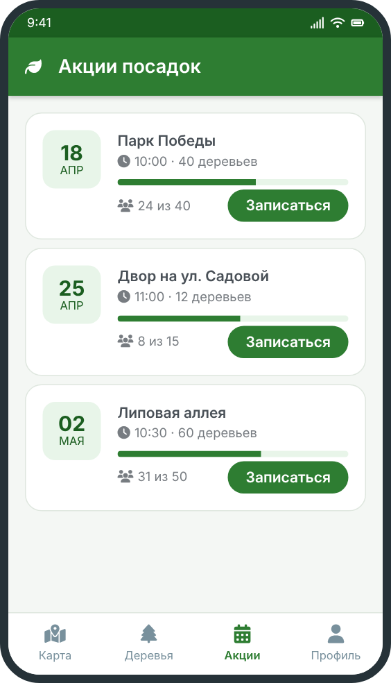
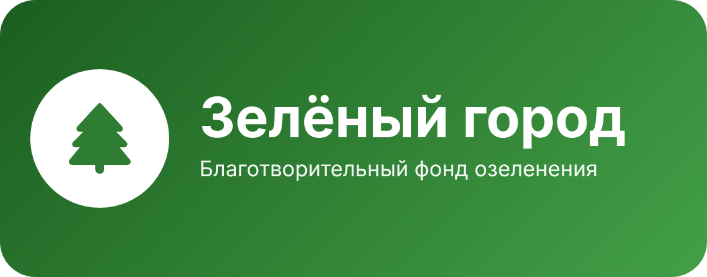

# Акции посадок

Акция посадки — это совместное мероприятие, где волонтёры сажают деревья в определённом месте города. Расписание ближайших акций находится на вкладке **«Акции»**.

## Что известно об акции

- дата, время и место проведения;
- сколько деревьев планируется посадить;
- какие породы будут посажены;
- сколько участников нужно и сколько уже записалось;
- что взять с собой: перчатки, воду, удобную обувь.

## Как проходит акция

1. Участники собираются на месте и получают саженцы и инструменты.
2. Координатор показывает, где и как сажать.
3. После посадки у каждого дерева ставится табличка с номером.
4. Дерево фотографируется и вносится в [реестр](../trees/).

<u>Важно:</u> инструменты и саженцы выдаёт фонд, платить за участие не нужно.

## Запись на акцию

Подробная инструкция: [запись на акцию](signup/).

Нажмите на логотип, чтобы вернуться на главную:

