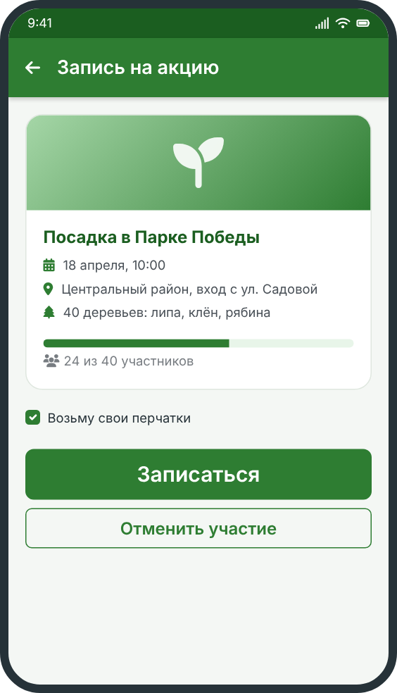

# Запись на акцию



Чтобы участвовать в посадке, нужно записаться заранее. Так координатор поймёт, сколько саженцев и инструментов подготовить.

## Как записаться

1. Откройте вкладку **«Акции»**.
2. Выберите подходящую акцию по дате и району.
3. Нажмите **«Записаться»**.
4. Подтвердите участие: придёт напоминание за день до акции.

## Если планы изменились

<u>Отмените</u> запись заранее: в карточке акции нажмите **«Отменить участие»**. Освободившееся место займёт другой волонтёр.

## Пример QR-пропуска

После записи приложение выдаёт код участника. Его показывают координатору на месте. Выглядит он примерно так:

```
PASS-2026-04-18-CEN-0042
```

## После акции

В разделе **«Мои деревья»** появятся деревья, которые вы посадили, с их номерами. Как устроены номера: [нумерация деревьев](../../trees/numbering/).

## Навигация

- [Назад к акциям](../)
- [Частые вопросы](../../faq/)
