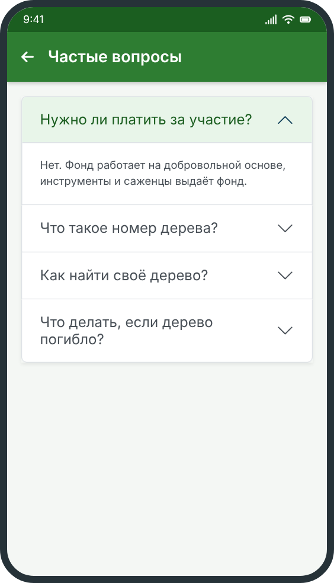
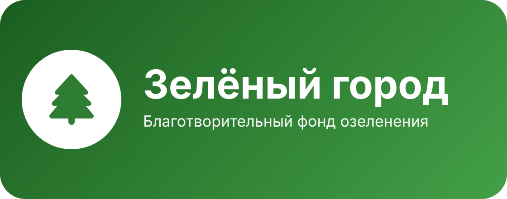

# Частые вопросы



## Нужно ли платить за участие в посадках?

Нет. Фонд «Зелёный город» работает на добровольной основе, участие и инструменты бесплатные. Денежные сборы в приложении не ведутся.

## Что такое номер дерева?

Это уникальный код дерева в формате `ZG-CEN-2026-000125`. Он нужен, чтобы отслеживать каждое посаженное дерево. Подробнее: [нумерация деревьев](../trees/numbering/).

## Как найти посаженное мной дерево?

Откройте профиль и выберите раздел «Мои деревья». Или введите номер дерева в поиске [реестра](../trees/).

## Что делать, если дерево сломано или засохло?

Откройте карточку дерева, выберите «Осмотр», отметьте состояние «Нужен уход» или «Утрачено» и приложите фото. Подробнее: [уход за деревом](../trees/care/).

## Как связаться с фондом?

Напишите нам на электронную почту:

```
help@zelenygorod.example
```

## Где посмотреть другие разделы?

- [Начало работы](../start/)
- [Реестр деревьев](../trees/)
- [Акции посадок](../actions/)

## Полезные ссылки

[Справка по Markdown](https://docs.github.com/ru/get-started/writing-on-github/getting-started-with-writing-and-formatting-on-github/basic-writing-and-formatting-syntax)

Нажмите на картинку, чтобы вернуться на главную:

[](../)
