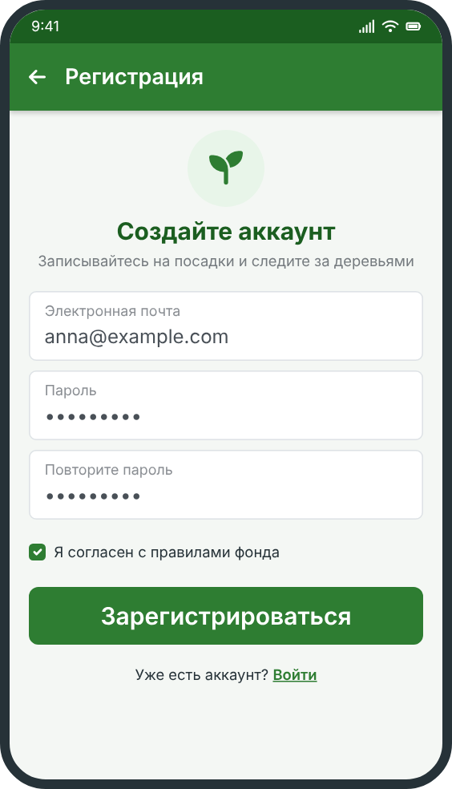

# Начало работы

Чтобы начать пользоваться приложением «Зелёный город», выполните несколько простых шагов.

## Установка

1. Откройте магазин приложений на телефоне.
2. Найдите приложение «Зелёный город».
3. Нажмите «Установить» и дождитесь окончания загрузки.

## Регистрация

1. Запустите приложение и нажмите **«Зарегистрироваться»**.
2. Введите адрес электронной почты и придумайте пароль.
3. Подтвердите почту: на неё придёт письмо со ссылкой.

<u>Обратите внимание:</u> пока почта не подтверждена, запись на акции недоступна.

## Что дальше

- Заполните профиль: [настройка профиля](account/).
- Посмотрите, как устроен реестр деревьев: [реестр деревьев](../trees/).
- Если что-то не получается, загляните в [частые вопросы](../faq/).

[Вернуться на главную](../)
