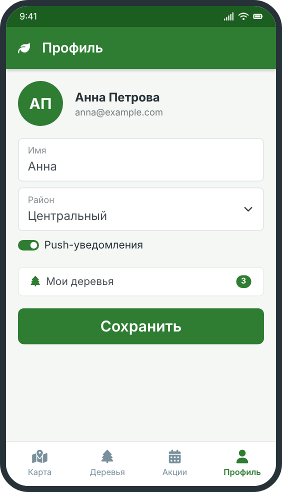

# Настройка профиля



В профиле хранятся ваши данные, список ваших деревьев и настройки уведомлений.

## Что можно указать

- имя, которое увидят другие участники (можно скрыть);
- район города, где вы чаще всего бываете: так приложение предложит ближайшие акции;
- способ уведомлений: push-сообщения или письмо.

## Мои деревья

В разделе **«Мои деревья»** собраны все деревья, которые вы посадили или за которыми ухаживаете. У каждого дерева виден номер, фото и статус. Подробнее о номерах: [нумерация деревьев](../../trees/numbering/).

## Безопасность

<u>Никому не сообщайте</u> свой пароль и код из письма, в том числе сотрудникам фонда. Сотрудники никогда не запрашивают эти данные.

## Пример ссылки-приглашения

Приложение может создать ссылку, чтобы пригласить друга на акцию. Выглядит она так:

```
https://zelenygorod.example/invite?code=ABC123
```

Отправьте её другу любым удобным способом.

## Навигация

- [Назад к началу работы](../)
- [Перейти к реестру деревьев](../../trees/)
