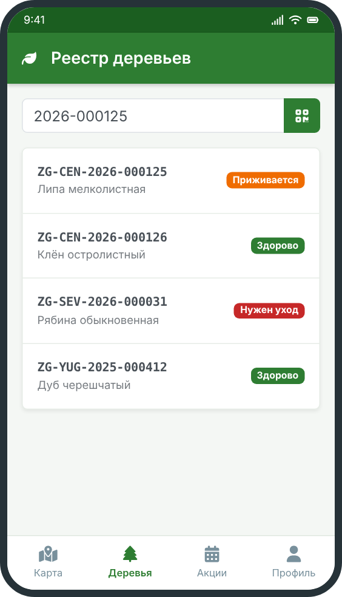

# Реестр деревьев

**Реестр деревьев** — это единая база всех деревьев и кустарников, которые посадил фонд «Зелёный город». Каждая запись в реестре — это одно дерево со своим номером, местом посадки, датой и фотографиями.

## Зачем нужен реестр

- видеть, сколько деревьев посажено в каждом районе города;
- находить своё дерево на карте и следить за его состоянием;
- вовремя замечать больные или погибшие саженцы и заменять их;
- показывать жителям, что посадки действительно растут.

## Что есть в карточке дерева

- уникальный номер (подробнее: [нумерация деревьев](numbering/));
- порода: например, липа, клён, рябина;
- место посадки и точка на карте;
- дата посадки и фото;
- текущий статус и история осмотров;
- имя участников, которые его посадили (если они не скрыли имя).

## Статусы дерева

1. **Посажено:** саженец только что высажен.
2. **Приживается:** идёт первый год после посадки.
3. **Здорово:** дерево растёт нормально.
4. **Нужен уход:** требуется полив, обрезка или защита.
5. **Утрачено:** дерево погибло; место ждёт новой посадки.

<u>Важно:</u> номер погибшего дерева не передаётся новому. Новое дерево на том же месте получает свой номер.

## Другие разделы

- [Как ухаживать за деревом](care/)
- [Записаться на посадку](../actions/)

Нажмите на логотип, чтобы вернуться на главную:

