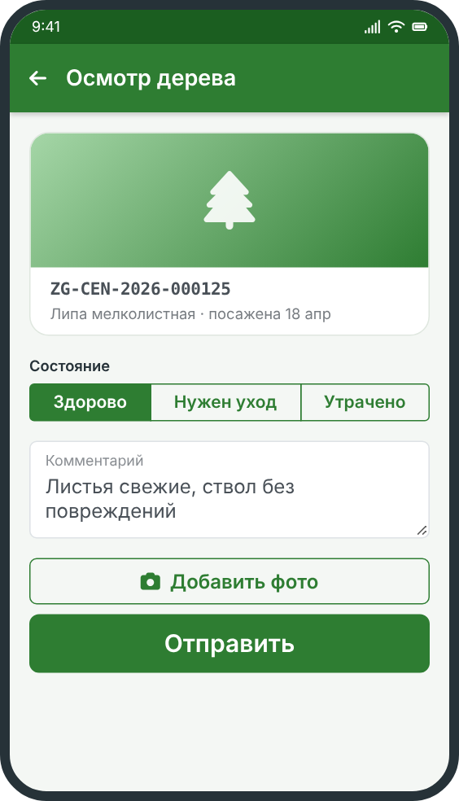

# Уход за деревом



Посадить дерево — только начало. Чтобы оно прижилось, нужно регулярно проверять его состояние. Любой участник может стать «хранителем» дерева и присылать фонду отчёты об осмотрах.

## Как стать хранителем

1. Откройте карточку дерева в [реестре](../).
2. Нажмите **«Стать хранителем»**.
3. Дерево появится в разделе **«Мои деревья»** вашего профиля.

## Когда осматривать дерево

1. Через месяц после посадки.
2. Раз в сезон в течение первого года.
3. После сильного ветра, мороза или засухи.

## Как отправить отчёт об осмотре

1. Откройте карточку дерева и нажмите **«Осмотр»**.
2. Сделайте фотографию дерева целиком.
3. Выберите состояние: «Здорово», «Нужен уход» или «Утрачено».
4. При необходимости добавьте комментарий и нажмите **«Отправить»**.

<u>Обратите внимание:</u> если дерево сломано или засохло, обязательно выберите «Нужен уход» или «Утрачено» и приложите фото: так фонд быстрее отреагирует.

## Простые правила ухода

- в первый год в жаркую погоду дерево нужно поливать;
- нельзя привязывать к стволу провода и рекламные объявления;
- не обрезайте ветви без согласования с фондом.

## Пример отчёта об осмотре

Так выглядит отчёт, который приложение отправляет в реестр:

```
{
  "tree": "ZG-CEN-2026-000125",
  "date": "2026-05-20",
  "state": "Здорово",
  "photo": "inspection_0520.jpg"
}
```

## Навигация

- [Назад к реестру деревьев](../)
- [Нумерация деревьев](../numbering/)
